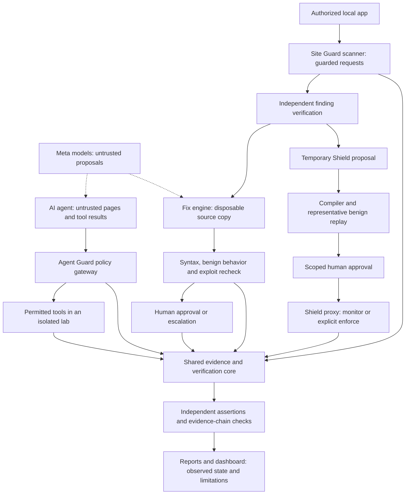

# Sentinel X

**Sentinel X: a verification-first guard for AI agents and vibe-coded sites. Models propose; deterministic code and independent tests decide.**

Sentinel X checks an AI agent's proposed actions and tests vulnerabilities in applications you are authorized to inspect.
It records evidence, independently checks outcomes and proposed patches, and offers narrow, human-approved temporary proxy rules while fixes are reviewed.

## At a glance

- **What:** a verification-first guard for AI agents and for web apps you are authorized to test.
- **Idea:** models propose; deterministic code and independent tests decide.
- **Built for:** the Meta AI Hackathon (Sentinel X).
- **Status:** local lab prototype. Non-lab scanning is disabled.
- **Limits:** results are from our own lab targets, not proof of complete protection. See the sections below.

[](https://github.com/satvikp-coder/sentinelx/actions/workflows/ci.yml)
[](LICENSE)

**Local lab prototype. Non-lab scanning is disabled.**
**[Watch/download the 2:55 demo](https://github.com/satvikp-coder/sentinelx/releases/tag/hackathon-demo-2026-11-05)** · [Direct MP4](https://github.com/satvikp-coder/sentinelx/releases/download/hackathon-demo-2026-11-05/sentinelx_demo.mp4)
[Final demo script](demo/script.md) · [Storyboard](demo/storyboard.md) · [Build guide](demo/README.md) · [Submission copy](demo/SUBMISSION_TEXT.md)

## Watch or reproduce the demo

The final demo is **2:55, 1920×1080 at 30 fps**, with narration, burned-in captions
and a silent captioned alternative. The MP4 files are deliberately gitignored
and hosted as assets on the [hackathon demo prerelease](https://github.com/satvikp-coder/sentinelx/releases/tag/hackathon-demo-2026-11-05),
not committed to source history. Download the narrated or silent captioned version
from that page. This is a lab-prototype demonstration, not a production release.

After a local build, open `demo/out/sentinelx_demo.mp4` or
`demo/out/sentinelx_demo_silent.mp4`. Voiceover and subtitles are also exported as
`demo/out/voice.wav` and `demo/out/narration.srt`. See the
[reproduction guide](demo/README.md) for the capture and build commands.

The video shows fresh offline SDK execution, a fresh authorized Node-lab scan,
separate API/proxy processes enforcing a rule over actual loopback HTTP, removal
restoring forwarding, and an evidence tamper check. It clearly distinguishes
the **SIMULATED** agent from **OBSERVED** HTTP behavior and independently
**VERIFIED** checks. Historical model, patch/PHP and three-way Shield results
are labelled stored evidence, not new runs. No new model calls were made.

All numerical claims are cross-checked in [the number audit](demo/number_check.md).
The fresh scan's coverage is kept separate from historical coverage and planted
recall. [Media verification](demo/MEDIA_VERIFICATION.md) records the actual export
metadata and sampled-frame inspection. The owner should review the complete
playback and narration before uploading. These are our own lab demonstrations,
not evidence of complete protection or production readiness.

## The problem

Agents read pages, retrieved text and tool results that can contain hostile instructions.
A successful legitimate task does not prove that an agent avoided an unauthorized action.
Vibe-coded shops and note apps can also ship authorization, injection and configuration flaws;
a plausible model explanation is not proof that a vulnerability exists or that a patch fixes it.

## Real-world use cases — demonstrated on our own lab targets only

1. **An agent developer** wraps a browsing agent's tools with Agent Guard. In the
   controlled hostile-page fixture, a hidden instruction attempts secret egress;
   scenario-specific policy and page-egress controls prevent the forbidden action.
   The independent verifier checks executed outcomes. This does not establish
   universal prompt-injection prevention for arbitrary agents or websites.
2. **A solo founder** tests an AI-generated shop or notes app in an authorized local
   lab. Site Guard produces independently rechecked findings, proposes patches on
   disposable source copies, and escalates rejected or human-required work.
   A narrowly scoped temporary Shield can protect the proxy path while a human
   reviews the fix. Shield is **TEMPORARY MITIGATION, NOT A FIX**.

## Architecture



A model cannot authorize a tool, approve its own patch or supply its own verifier verdict.
Tamper-evident hash chains are not authentication against a malicious database writer.

## Results — historical stored examples, not a new benchmark

These are the latest **committed example snapshots**, with different run dates and
coverage. They are not measurements of every later code change. Every outcome below
links to stored JSON; scanner recall also requires its companion ground-truth scoring
artifact. None was regenerated or relabeled as a fresh live-model run for this README.

| Component / label | Recorded result and denominator | Source |
|---|---|---|
| Agent Guard — **SIMULATED** scripted agent | Gated arm blocked **15/15** observed attack attempts; **0/81** benign tool actions falsely blocked. There were **3/81** confirmations and **12/15** benign tasks completed. | [report.json](evaluations/example_report/report.json), `arms.B.overall` |
| Agent Guard — **OBSERVED**, recorded historical LIVE NVIDIA model | `meta/muse-glimmer-30b`: forbidden outcomes in **2/5** valid unprotected attack runs versus **0/4** valid gated attack runs. Tiny sample; **4/20** total runs invalid. No statistical improvement claim. | [report.json](evaluations/example_report_model/report.json), `arms.A/B.overall.attack_success_rate`, `invalid_runs` |
| Scanner — **OBSERVED / SCORED** on the Node lab | **6/10** planted weaknesses matched by the stored scorer; **36/37** check/endpoint ledger cells exercised (**97.3%**). Coverage is not vulnerability recall. | [report.json](evaluations/example_scan_report/vibe_notes_node/report.json), `coverage_ledger.rows`; [scoring.json](evaluations/example_scan_report/vibe_notes_node/scoring.json), `overall_recall` |
| Fix engine — **independently VERIFIED** recorded proposals | **2/8** proposals independently verified and awaiting human approval; **6/8** escalated. Verified does not mean applied or deployed. | [report.json](evaluations/example_fix_report/report.json), `results[].verification_status`, `results[].status` |
| Shield — **OBSERVED** synthetic local HTTP traffic | Enforce arm blocked **38/65** attack requests; **0/40** benign requests blocked/altered. Injection stage: **0/8** blocked — **injection NOT protected** in this example. | [report.json](evaluations/example_shield_report/report.json), `arms.C.attack`, `arms.C.benign` |
| Shield intent labels — **OBSERVED**, low accuracy | Correct labels for **0/19** object-enumeration requests and **0/6** admin probes in the recorded enforce arm. Model confidence grants no permission. | [report.json](evaluations/example_shield_report/report.json), `arms.C.intent_accuracy` |

**Shield benign caveat:** the example scopes rules to the attacker's client key;
benign replay uses another key. Its zero benign blocks are by construction, not
evidence of zero collateral blocking on arbitrary applications. The original
report explicitly records this caveat.

The historical clean-reference report also contains a false-positive public-settings
GET finding. It is retained, explained in [the final check](tasks/FINAL_CHECK.md),
and must not be counted as a genuine unplanted vulnerability. Missing evidence
databases remain NO_DB/MISSING; an export cannot recreate them.

## Agent Guard quickstart — offline

Windows CMD, from a clean source checkout; Python 3.11+ required. These commands
need no model credential file. For macOS/Linux use the equivalent venv activation.

```bat
python -m venv .venv
.venv\Scripts\activate.bat
python -m pip install -e .
python -m pip install -e sdk/python
sentinelx doctor
python examples/agent_guard_basic.py
sentinelx agent check --policy configs/policy/default.yaml --action examples/agent_guard_action.json
```

The example uses synthetic hostile input and stubbed tools: **SIMULATED, no LLM,
no external request**. Enforce mode prints BLOCKED and the legitimate read still
prints COMPLETED. Monitor mode logs what would be blocked and allows its stubbed
tool to run; do not confuse that mode with enforcement.

Python SDK usage (the function below deliberately does not perform network I/O):

```python
from sentinelx_agent_guard import Guard, GuardBlocked

guard = Guard("examples/agent_guard_policy.yaml", mode="enforce")

@guard.tool("fetch_page")
def fetch_page(url: str) -> str:
    return "synthetic page"

print(fetch_page("http://orders.lab.test/cart"))
try:
    fetch_page("https://outside.example/collect")
except GuardBlocked as exc:
    print("BLOCKED:", exc.reason_code)
```

The example policy accepts exactly `allowed_hosts`, `allowed_tools`,
`high_impact_actions` and `secret_patterns`. Unknown configuration fields fail.
The [TypeScript SDK](sdk/typescript) uses an authenticated local sidecar; it needs
a real server-issued session/run. Its [runtime tests](sdk/typescript/tests/runtime.cjs)
exercise wrapped-tool counters and fail-closed behavior. Do not use a made-up
session identifier as proof of a successful integration.

## Site Guard quickstart — authorized Node lab only

Needs Node.js; Docker is not required for this Node workflow. Use only the disposable
synthetic application shipped here. Ensure ports 18081 and 18090 are free; do not
terminate unrelated services. The reset command discards only the lab's synthetic data.

```bat
python scripts/lab_up.py vibe_notes_node
python scripts/lab_reset.py vibe_notes_node
sentinelx init
sentinelx site add http://127.0.0.1:18081 --lab
sentinelx site verify vibe_notes_node
sentinelx site scan vibe_notes_node
python scripts/lab_up.py vibe_notes_node
sentinelx site guard --upstream http://127.0.0.1:18081 --listen 127.0.0.1:18090 --mode monitor
```

The guard command stays running. In another activated CMD terminal, send a benign
request through the proxy:

```bat
curl http://127.0.0.1:18090/health
```

Stop only that guard process with Ctrl+C, then inspect results and stop your lab:

```bat
sentinelx site report vibe_notes_node
sentinelx shield list
python scripts/lab_down.py vibe_notes_node
```

`site scan` stops its lab when finished, hence the restart before the proxy.
Monitor mode never blocks. A successful monitor request is not proof of enforce mode.
The repeatable [README smoke script](scripts/readme_smoke.py) runs these quickstart
flows, sends an actual benign proxy request and checks cleanup. For actual public
proposal → approval → enforce → removal, use the [recording guide](docs/SUBMISSION_RECORDING_GUIDE.md)
and [separate-process regression](tests/integration/test_shield_public_processes.py).
No paid/live stage is needed for either quickstart.

## Models used and provenance

| Recorded integration | Role and evidence status |
|---|---|
| Meta open-weight `meta/muse-glimmer-30b` via NVIDIA | Historical LIVE planner/investigator traces and model-assisted examples. Current quickstarts are offline. |
| Meta open-weight `meta-models/muse-spark-open-1026` via Baseten | Historical usage record and `baseten_spark_open` fix-report attribution; not a new live run or independently authenticated provider receipt. |

See [model evidence](docs/SUBMISSION_MODEL_EVIDENCE.md) for distinctions between
historical LIVE traces, recorded artifacts, scripted simulation, mocks and the
aborted full run. The full live-model benchmark was not completed. No new model
calls are made by this README. Provider availability and prices require owner
verification; unknown NVIDIA cost is not summed as a billed zero. Never commit
credentials or infer event eligibility merely from a configured model identifier.

## Development and CLI

From the activated venv and repository root:

```bat
python -m pip install -e ".[dev]"
sentinelx --help
python -m ruff check .
python -m pytest -m "not slow" -p no:cacheprovider --basetemp=%TEMP%\sentinelx-readme-fast
npm install
npm run build
npm test --workspace sdk/typescript
```

Use a fresh basetemp name each run; do not delete an unknown existing directory.
The fast suite excludes slow/browser/Docker/live cases. Hosted CI separately runs
the full configured suite; the badge links to actual results. A skipped live test
is not a passed model evaluation. The API/dashboard setup is described in the
[recording guide](docs/SUBMISSION_RECORDING_GUIDE.md), not required by the offline SDK example.

## Repository layout

| Path | Purpose |
|---|---|
| `packages/` | Policy, evidence, agent runtime, independent verifier, evaluation, scanner, fixer, Shield and reports |
| `apps/` | API, dashboard and local fixture/lab management |
| `sdk/python/`, `sdk/typescript/` | Tool-wrapping SDKs |
| `labs/`, `fixtures/` | Intentionally vulnerable synthetic apps and controlled agent scenarios |
| `evaluations/` | Committed historical example reports; generated runs remain local |
| `demo/` | Final narration, storyboard, numerical audit, build scripts and portal copy; rendered media stays local in ignored `demo/out/` |
| `tests/` | Unit, integration, browser and Docker checks with explicit prerequisites |
| `scripts/`, `docs/`, `tasks/` | Reproduction tools, scope/attribution, evidence and handoffs |

## Safety and honest limitations

- **Lab-only:** non-lab scanning is disabled in this release. An authorization gate
  guards scanner requests, scope, redirects and budgets. Only test targets you own
  or have explicit permission to assess; see [SECURITY.md](SECURITY.md).
- Kill switches and request/cost/call budgets exist; no auto-apply or production
  deployment is part of the quickstarts. Shield defaults to monitor; enforce requires
  explicit scoped approval and representative benign replay.
- One trusted local API writer and loopback proxy readers share a private runtime
  database. Demo Bearer authentication is not production multi-user authorization.
  Database hashes detect certain tampering, not a malicious authorized writer.
- Attempted is not executed; candidate is not confirmed; proposed is not VERIFIED;
  VERIFIED is not applied. A temporary Shield is not a source-code fix.
- Results are small synthetic lab snapshots, not protection guarantees, universal
  detection/recall, zero false positives or a production-grade security assessment.
  Injection was not protected in the recorded Shield example; intent accuracy is low.
- External scanner operation was not performed and remains disabled pending separate
  approval. Docker/PHP and browser tests require their prerequisites; count only
  actual executions. Final video review, portal submission and saving its receipt
  remain owner actions. Confirm that the portal accepts the linked video hosting;
  upload the same MP4 to the required host if its rules specify one.

## AI assistance, scope and license

Built with AI coding agents including OpenCode and Codex, under human developer
direction and review. Independent automated checks provide the executed evidence;
this is not a claim that a human manually audited every line or that a formal
third-party security certification occurred.

See [hackathon scope](docs/HACKATHON_SCOPE.md), [third-party inventory](docs/THIRD_PARTY_INVENTORY.md)
and [rules/compliance](docs/RULES_COMPLIANCE.md). Organizer correspondence and
accepted-participant requirements must be supplied/confirmed by the owner.

**MIT License — Copyright (c) 2026 Satvik Patel.** See [LICENSE](LICENSE).
Third-party dependencies retain their own licenses. No package publication or
hackathon submission is performed by these instructions.
